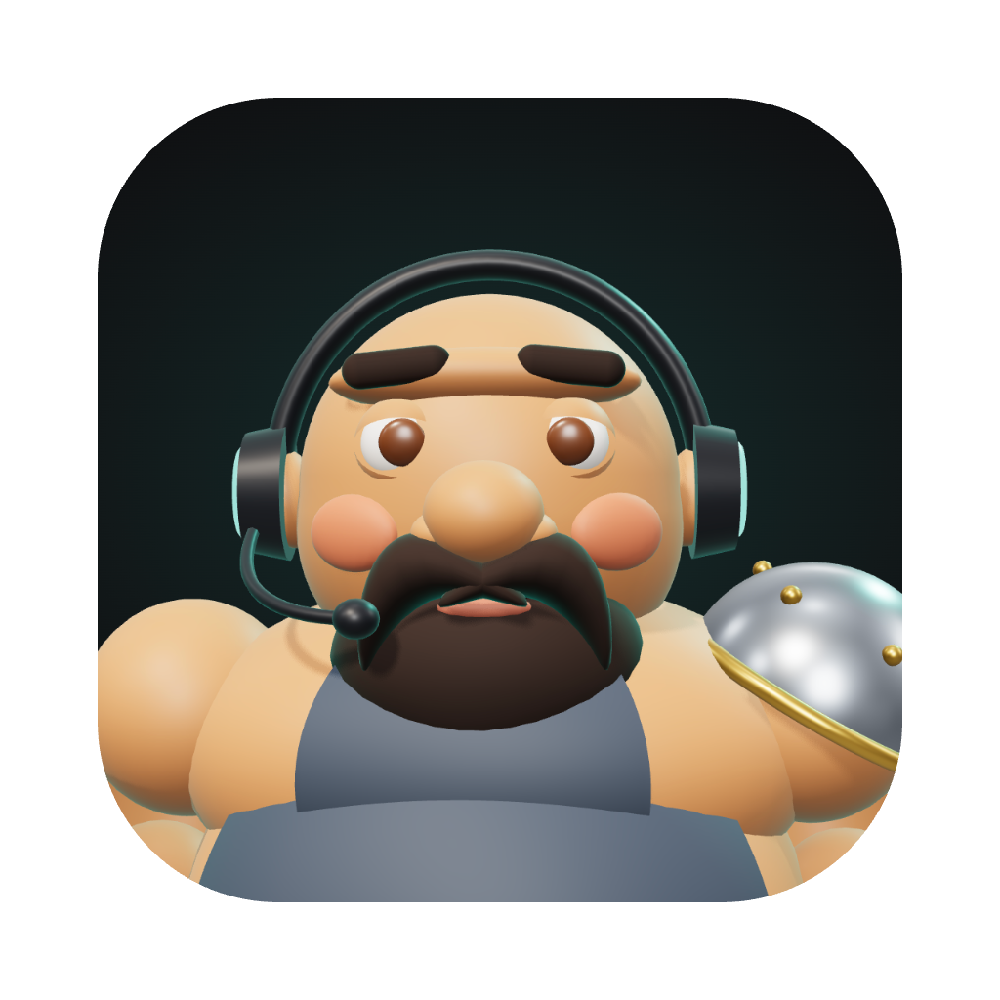
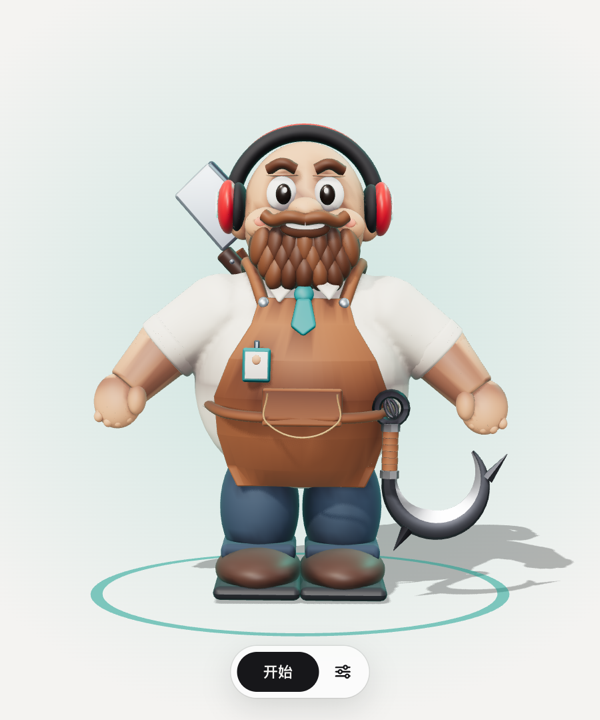
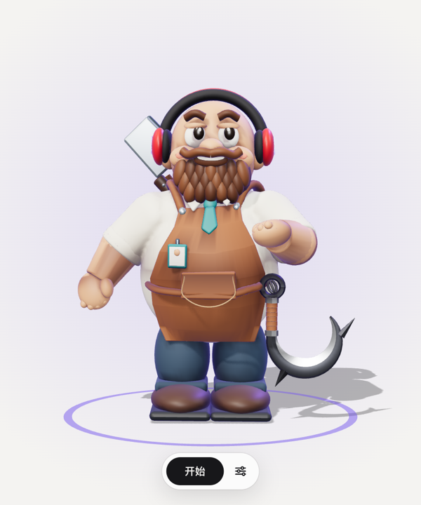
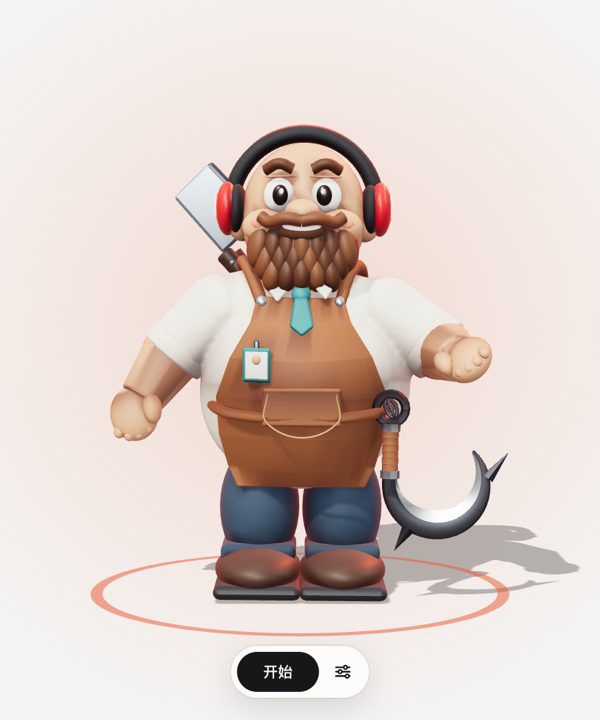

<p align="center"></p>
<h1 align="center">会议数字人</h1>
<p align="center">跑在你自己电脑上的 AI 与会者：陪你开会，也可以替你去开会。</p>
<p align="center">
  
  
  
</p>

<p align="center">
  
  
  
  
</p>
<p align="center"><sub>在听 · 在想 · 想发言 · 在说</sub></p>

> **meeting-avatar** — an AI attendee that runs on your own Mac. It listens to multi-speaker meetings, waits for its turn,
> stops when interrupted, looks things up in the background, and writes the minutes afterwards. Speech recognition,
> voice activity detection, speaker identification and speech synthesis all run locally; the brain is the `claude` CLI
> you are already logged in to. The interface and the recognition models are tuned for Mandarin Chinese.

## 它是什么

你的 AI 分身，陪你开会，也可以替你去开会：

- **会接话**：听得懂多人讨论，等别人把话说完再接，别人一插话就停下。
- **会干活**：认识你电脑上的所有项目，能在后台查代码、联网查资料、翻以前的会议、出设计稿，查完口头汇报。
- **会记录**：散会后自动整理纪要（结论、待办、没定的事），你自己的 Claude Code、Codex 和别的智能体可以直接读到每一场会。
- **在本机**：语音识别、断句、声纹、语音合成全部在本地运行；大脑用的是本机已登录的 `claude` 命令行，不需要任何密钥。
- **两种会都行**：当面开会和线上会议（腾讯会议、飞书等）共用同一套。

## 需要什么

| | |
|---|---|
| 电脑 | Mac，Apple 芯片。在 M1 / 16GB 上开发和实测；Windows 和 Linux 没有适配 |
| [uv](https://docs.astral.sh/uv/) | 装依赖和运行后台。Python（3.11 或 3.12）由它准备，不用自己装 |
| [Claude Code](https://claude.com/claude-code) 命令行 | 它的大脑。要在终端里能运行 `claude` 并且已经登录；没有的话形象和界面起得来，但不会接话，也出不了纪要 |
| Node.js | 只有想要双击就开的桌面应用时才需要 |
| 磁盘 | 本地语音模型约 440MB |

## 安装

```bash
git clone https://github.com/fangsaturday6/meeting-avatar.git
cd meeting-avatar
uv sync                             # 装依赖
uv run python -m avatar.models      # 下载本地语音模型（约 440MB，逐个文件校验）
uv run python -m avatar             # 启动
```

然后用 Chrome 打开 http://127.0.0.1:8765/ ，点「开始」，对它说话。

想先看看长什么样，不下载模型、不需要 Claude 也行：

```bash
uv run python -m avatar.demo --autoplay
```

打开 http://127.0.0.1:8767/ ，它会自己演一场会。

### 装成桌面应用

```bash
cd app && npm install && npm run pack
```

打包出 `app/dist/小克.app`，拖到「应用程序」里，之后双击「小克」就行。应用会自己把后台起起来，退出时一起关掉；
后台已经在跑的话就直接接上。这个应用记着项目文件夹的位置，挪了项目就重新打包一次；换个名字：`npm run pack -- 大锤`。

依赖默认从国内镜像下载（`pyproject.toml` 里的清华源、`app/.npmrc` 里的 npmmirror）。在别的网络下嫌慢，把这两处删掉就走官方源。

## 界面

它是一个桌面应用：打开就是它本人，没有别的。

| 窗口 | 里面有什么 |
|---|---|
| 主窗口 | 只有它本人。状态看颜色和动作：闭眼=没开会，青=在听，紫=托下巴在想，琥珀=举手想发言，橙红=在说；头顶有光球在转=后台在干活；话筒翻上去=已静音 |
| 设置窗口 | 「记录」：对话、任务、打字发言、派任务、以前的会议和纪要；「设置」：会议背景、陪我还是替我开会、它说多少、场景、名字、嗓音、麦克风和扬声器、把会议记录接给你自己的智能体等 |

主窗口底部的控制条：会前是「开始」和设置；开会后是静音、让它停下、结束会议、会议记录、设置，鼠标动一下才出现。
同样的操作在菜单栏「会议」里也有，带快捷键。

## 当面开会

1. 点设置，填上你的名字，选「陪我开会」还是「替我开会」，场景选「当面开会」，填好会议背景和这场会聊的项目。
2. 点「开始」，第一次会问你要麦克风权限。会议开始和接通声音是同一步。
3. 直接对它说话。叫它名字它一定回答；平时它自己判断该不该开口。
4. 在「记录」里点对话中的名字可以改名，之后它就知道谁是谁。

想给大家看就把主窗口投到电视或投影上。笔记本自带麦克风大约 2 米内可用；会议室大的话接一个会议全向麦，
在设置里选麦克风。

## 线上会议

数字人作为一个独立的与会者入会，所以这台电脑上的会议软件要登录数字人自己的账号，你本人用手机或另一台电脑入会。

1. 安装两个虚拟声卡和 OBS（需要管理员密码，只做一次）：

   ```bash
   brew install blackhole-2ch blackhole-16ch
   ```

   ```bash
   brew install --cask obs
   ```

2. 会议软件的音频设置：扬声器选 **BlackHole 2ch**，麦克风选 **BlackHole 16ch**。
3. 设置里：场景选「线上会议」，麦克风选 **BlackHole 2ch**（听会议里的人），扬声器选 **BlackHole 16ch**（把它的声音送进会议）。
4. OBS：添加「窗口采集」选小克的主窗口，点「启动虚拟摄像头」；会议软件的摄像头选 **OBS Virtual Camera**。
5. 建议把会议里的昵称写成「小克（AI）」这样，让其他人知道它不是真人。

## 它能做什么

| 你说 | 它做 |
|---|---|
| 「小克，你怎么看」 | 直接回答，先说结论 |
| 别人之间在讨论、有人在讲议程 | 安静听；有实质补充时等空档再说 |
| 一句话中间停顿了几次 | 等你说完再想，不会抢着回答半句话 |
| 它说话时你插话 | 约 1 秒内停下，顺着你的话接 |
| 它说话时你只是「嗯」「对」了一声 | 接着把话说完，一字不改 |
| 叫了它但它一时答不上来 | 先应一声「嗯，我想一下」，网络卡了会照实说 |
| 「你别老插话」「你怎么不说话」 | 回一句「好」，自己把参与度调低或调高（设置窗口最上面那一排同步变化） |
| 「查一下飞书有没有这个接口」 | 说「我查一下」，后台联网查，查完口头汇报 |
| 「供应商那个接口上线了吗」 | 从你所有的项目里找到对的那个，只读方式查代码 |
| 「上次开会怎么定的」 | 后台翻以前的会议记录和纪要 |
| 「出一版登录页」 | 后台调用本机 Claude 写一个网页设计稿，显示在主窗口的资料板上 |
| 冷场 6 秒 | 有没定的事就推一把，没有就不说 |
| 「今天就到这」 | 用两三句话过一遍结论和谁做什么 |

### 陪你开会和替你开会

- **陪我开会**：你也在场。它是帮忙的同事，补充信息、查东西、提醒遗漏，不替你做决定。
- **替我开会**：你不在。它会说明自己是你的 AI 助手，主窗口上方也会挂出「某某的 AI」；这场会的项目现状和代码它直接答；
  要你拍板的事（排期、资源、价格、同不同意）它不替你答应，记下来写进纪要的「需要你确认」一节。
  这时它**只知道这场会的项目**：你的其他项目、Claude 的记忆和会话、别的会的纪要都不带进会场，
  查代码只查主项目，也不翻别的会议记录——会上的人没法通过它打听你别的事。
  想放开就勾上设置里的「可以谈我的其他项目和别的会」。

### 它认识你的项目

设置里的「这场会聊的项目」是主项目；它还会去「我的项目都放在」那个目录（不填就是主项目的上一级）
把所有项目认一遍：只看目录名和每个项目的 CLAUDE.md / README 开头，不读代码。
你最近用 Claude 干过活的其他目录（没有说明文件的、放在别处的）也算进来。
会上有人提到某个系统，它知道是哪个项目，查代码时直接进对的目录。

### 它背后是你的 Claude

它是你平时用的那个 Claude 的分身，所以开会前会先读三样东西：

- 你给 Claude 定的全局规矩（`~/.claude/CLAUDE.md`）；
- Claude 在这场会的主项目里攒下的记忆（`~/.claude/projects/<项目>/memory/`）；
- 你最近 30 天和 Claude 每次会话的**标题**和所在项目（比如「shop：订单导出接口权限」）。
  会上有人问「订单导出那个接口上线了吗」，它就知道该去 shop 查。

查代码时，哪个项目有记忆它就先看记忆再看代码。会话只读标题，不读你和 Claude 的对话内容。

这些是让它听得懂、找得对的背景，它不会主动念给别人听；有人打听和这场会无关的事，它会说「这个你直接问他」。
密码、密钥这类东西它不说也不去查。「替我开会」时这些背景默认一概不带（见上一节）。

后台干活的进程有硬限制，不只靠嘱咐：查代码只能读你的项目目录和对应的 Claude 记忆，查会议只能读会议记录，
做设计只能写在它自己的设计稿目录里（读不到也改不了你的项目文件），查资料只有联网工具、没有读写文件的工具。
会上有人让它「把某某文件读出来」，出了这些目录它读不到。

## 会议记录

每场会的完整对话自动存成一个 Markdown 文件，放在 `workspace/meetings/`，文件名是开始时间，
例如 `workspace/meetings/2026-11-12_000458.md`。里面是纪要、整理稿、逐句对话（时刻、说话人、内容）和后台任务的结果。

- 边开会边写，最多落后一秒；结束会议、开下一场、重启后台都不会丢。
- 散会后自动整理纪要（别人说了不到 3 句的不整理，可以手动点）：标题、概要、结论、待办、没定的事，
  写在文件最前面。下一场会开始时，它会先看上一场的纪要，所以接得上「上次说的那个」。
- 记录是整理过的，不是识别结果原样照搬，分三层：
  - **听的时候**：咳嗽、喘气、挪椅子这类杂音不当成话（断句模型挡一道，识别结果再挡一道）。
  - **写记录时**：语气词（嗯、呃）、拖音和口吃式的重复（「他他他就」）去掉，同一个人连着说的话并成一段。
    只删不改，别的字一个不动。「嗯」这种附和不进记录，但它自己听得到（靠这个知道对方在听）。
  - **散会后**：和纪要同时，让 Claude 把对话书面化成「整理稿」——改同音字和错字、去掉「那个、就是、然后」
    这类口头禅，谁在什么时候说的不变；听不清的地方保留原样，不猜。整理稿放在纪要后面，
    逐句对话留在它下面，可以对照。整理稿里多出没说过话的人、写成了总结、删得只剩一点，都会被作废。
- 没点「结束会议」就断掉的会（后台被重启、电脑合盖、当时没网）也不会漏：每次启动后台，
  它会把最近还没有纪要的会补上。
- 会后给说话人改名，文件里的名字跟着改。
- 设置窗口的「记录」里，没开会时列的就是以前的会议，点一条就在窗口里读；可以重新整理纪要、复制文件路径。

### 让你自己的 AI 读会议

设置窗口最下面的「接给我的智能体」，一行一个：

- **Claude Code、Codex**：打开开关就接上了（在它们那边登记一个叫 `meetings` 的只读工具），再点一下取消。
  之后在任何项目里对它们说「看下刚才的会」「上次会上分给我什么事」「会上关于供应商接口怎么说的」，它们会自己去读。
  这台电脑上没装的那个不给开关。它们那边已经有一个同名的别的服务时不会动它，会告诉你。
- **其他智能体**（Cursor、Claude 桌面版、你自己写的程序等）：点「复制一段话发给它」，粘贴到它的对话框里，
  它照着把会议记录接成自己的工具。这段话里有三种接法，它挑自己支持的：HTTP 方式的 MCP（`http://127.0.0.1:8765/mcp`，
  数字人开着时可用）、本地命令方式的 MCP（数字人没开也能用）、不支持 MCP 就直接调下面的 `/api/meetings` 接口。
  有的工具不能改自己的配置，它会告诉你该往哪个文件里加什么。

不开界面也行，效果和打开那两个开关一样：

```bash
uv run python -m avatar.connect
```

接上之后有三个工具：

| 工具 | 作用 |
|---|---|
| `list_meetings` | 最近的会议：时间、时长、标题、说话人、有没有纪要、文件路径 |
| `read_meeting` | 读一场会（默认最近一场）；可以只要纪要、只要整理稿或只要逐句对话；长会分页读。正在开的会也读得到 |
| `search_meetings` | 在所有会议里搜关键词 |

登记给 Claude Code 和 Codex 的是本地命令方式，直接读文件，后台没在运行也能用。取消登记：关掉开关，或者
`uv run python -m avatar.connect --remove`。工具只能读；要让智能体重新整理纪要，调 `POST /api/meetings/{id}/minutes`。
`/mcp` 只给这台电脑上的程序用：浏览器里别的网站的页面发来的请求会被拒绝。

## 接口

界面上的每个操作都有对应接口，AI Agent 不读页面也能参会和控制。

| 方法 | 路径 | 作用 |
|---|---|---|
| GET | `/api/state` | 全量状态：字幕、说话人、任务、设置、会议记录列表 |
| POST | `/api/meeting/start`、`/api/meeting/stop` | 开始、结束会议 |
| POST | `/api/utterance` `{speaker, text}` | 以文字方式说一句话（没有麦克风时、Agent 参会时用） |
| POST | `/api/say` `{text}` | 让数字人直接念一句话 |
| POST | `/api/hush` | 让它立刻停下 |
| POST | `/api/mute` `{muted}` | 静音：只听不说 |
| PATCH | `/api/speakers/{id}` `{name}` | 说话人改名 |
| POST | `/api/tasks` `{kind, brief}` | 直接派后台任务，kind 为 查资料 / 查代码 / 查会议 / 做设计 |
| POST | `/api/board` `{task_id}` | 选择资料板显示哪个任务，`null` 为收起 |
| PATCH | `/api/settings` | 改设置，字段见下表 |
| GET | `/api/figures` | `avatar/web/models/` 里有哪些 3D 形象文件，各带了哪些状态的动作文件 |
| GET | `/api/meetings` | 会议记录列表，新的在前：编号、起止时间、标题、句数、说话人、有没有纪要、文件路径 |
| GET | `/api/meetings/{id}` | 一场会的完整内容（Markdown 文本）；`id` 写 `latest` 是最近一场 |
| POST | `/api/meetings/{id}/minutes` | 整理（或重新整理）这场会的纪要和整理稿，后台进行。纪要好了事件流里有 `minutes` 事件；整理稿晚一些，补进记录后再发一次 `meetings` 事件 |
| GET | `/api/agents` | 会议记录接给了哪些智能体：`clients` 里每个有 `id`（`claude` / `codex`）和 `state`（`on` 已接上 / `off` 没接 / `missing` 没装 / `taken` 那边有个同名的别的服务 / `unknown` 没能确认）；`guide` 是写给别的智能体看的接入说明，`mcp`、`api` 是其中的地址。要去问本机的 Claude Code 和 Codex，会花一两秒 |
| PUT | `/api/agents/{id}` `{connected}` | 把会议记录接给这个智能体，或者取消。动不了时回 409 和原因。成了之后事件流里有 `agents` 事件 |
| POST | `/mcp` | HTTP 方式的 MCP（一问一答，回 JSON），工具和登记给 Claude Code 的那套一样：`list_meetings`、`read_meeting`、`search_meetings`，都是只读的 |
| WS | `/ws/events` | 状态事件流，连接后先收到全量快照 |
| WS | `/ws/audio` | 主窗口的音频通道（同一时间只有一个窗口负责收音和播放） |

界面上的每个按钮和表单项都有固定的 `id`，改版不改名（`tests/test_pages.py` 里有清单并会检查）。它们和接口的对应关系：

| 界面元素 | 接口 |
|---|---|
| `#btn-start` 开始 | `POST /api/meeting/start`，同时在这个窗口接通声音 |
| `#btn-stop` 结束会议 | `POST /api/meeting/stop` |
| `#btn-mute` 静音 | `POST /api/mute` |
| `#btn-hush` 让它停下 | `POST /api/hush` |
| `#btn-board-close` 收起资料板、「记录」里的 `.task[data-task-id]` | `POST /api/board` |
| `#composer`（`#say-kind` 选「说话」） | `POST /api/utterance`，说话人是设置里「我的名字」 |
| `#composer`（`#say-kind` 选任务类型） | `POST /api/tasks` |
| 对话里的 `button.who[data-speaker-id]` | `PATCH /api/speakers/{id}` |
| `#settings` 里带 `name` 的每一项、每一组几选一（`data-setting`） | `PATCH /api/settings` |
| 「记录」里的 `#btn-meetings`、`.meeting[data-meeting-id]` | `GET /api/meetings`、`GET /api/meetings/{id}` |
| `#btn-minutes` 整理纪要 | `POST /api/meetings/{id}/minutes` |
| `#agent-claude`、`#agent-codex` 开关（`aria-checked` 是接没接上） | `PUT /api/agents/{id}` |
| `#btn-copy-agent-guide` 复制一段话发给它 | `GET /api/agents` 的 `guide` |

`#avatar-grip` 罩在形象身上：按住它左右拖，形象跟着转身，松手带一点惯性，几秒后自己转回正面；点一下（不拖）他做一个小动作。
只是看着玩，不改任何状态，所以没有对应接口；它周围的空白照旧用来拖动窗口。

主窗口的网址参数：`?autostart=1` 会议一开始就免点击接通声音（桌面应用默认带）；
`?pose=thinking&hearing&working&muted` 强行指定神态，看效果和截图用。

常用设置（`PATCH /api/settings`，设置窗口里都有对应的控件）：

| 字段 | 取值 | 控件 id |
|---|---|---|
| `name`、`owner` | 它的名字、你的名字 | `set-name`、`set-owner` |
| `role` | `companion` 陪我开会 / `delegate` 替我开会 | `set-role-companion`、`set-role-delegate` |
| `open_book` | 替我开会时能不能谈这场会之外的事，默认 `false` | `set-open-book` |
| `engagement` | `quiet` 少说 / `normal` 适中 / `active` 多说 | `engagement-quiet` 等，在设置窗口最上面 |
| `scene` | `room` 当面开会 / `online` 线上会议 | `set-scene-room`、`set-scene-online` |
| `project_dir`、`projects_root` | 这场会聊的项目、所有项目所在的目录 | `set-project`、`set-projects-root` |
| `topic` | 会议背景 | `set-topic` |
| `voice`、`speed` | 嗓音、语速 | `set-voice`、`set-speed` |

`/api/state` 里的 `projects` 是它认出来的项目，`minuting` 是正在整理纪要的会议。
`stage_online` 是有没有窗口接通了声音，`mic_online` 是那个窗口的麦克风声音有没有真的送到后台：
开着会、`stage_online` 为真而 `mic_online` 为假，就是它现在只能说、听不到（耳机断开、麦克风被拔掉），
主窗口会自己重新接麦克风，接不上时在顶部提示（`#btn-mic-retry` 重试）。事件流里这两项都走 `flag` 事件。

## 代码结构

| 文件 | 职责 |
|---|---|
| `avatar/floor.py` | 发言决策：什么时候想、什么时候开口、什么时候让话 |
| `avatar/ears.py` | 断句、识别（顺手挡掉杂音）、声纹 |
| `avatar/fast_brain.py` | 快脑：常驻的 Claude Haiku，负责接话。它怎么说话全在这个文件的提示词里 |
| `avatar/slow_brain.py` | 慢脑：按需启动本机 Claude Code 干活、会后整理纪要和整理稿 |
| `avatar/knowledge.py` | 它对你的了解：你电脑上有哪些项目、你的 Claude 记下的事 |
| `avatar/mouth.py` | 语音合成：本地优先，在线和系统语音兜底 |
| `avatar/meeting.py`、`speakers.py`、`config.py` | 会议状态、说话人、设置 |
| `avatar/archive.py` | 会议记录：写盘（去语气词、并成段）、列表、读取、纪要和整理稿 |
| `avatar/mcp_server.py`、`connect.py` | 把会议记录接给你自己的智能体：只读的 MCP 工具；登记到本机的 Claude Code 和 Codex；写给别的智能体看的接入说明 |
| `avatar/api.py` | REST 和 WebSocket |
| `avatar/web/stage.*` | 主窗口：形象、资料板、字幕、提示、控制条 |
| `avatar/web/panel.*` | 设置窗口：记录和设置 |
| `avatar/web/character.js` | 3D 舞台（镜头、灯光、状态色）和代码搭的备用形象（three.js，放在 `vendor/` 里，不联网）；`avatar.js` 是不支持 3D 时的 2D 备用形象 |
| `avatar/web/model.js` | 从 `avatar/web/models/` 加载做好的 3D 形象（GLB 文件），按状态播动作、驱动脸 |
| `tools/figure.py` | Blender 脚本：给形象绑骨、做每种状态的动作、导出 GLB |
| `avatar/web/api.js`、`audio.js` | 接口与状态、收音与播放（两个窗口共用） |
| `avatar/demo.py` | 演示后台：不需要模型、网络和 Claude，数据放临时目录 |
| `app/` | 桌面外壳（Electron）：起后台、开窗口、菜单；`pack.js` 打包，`setup.js` 安装 Electron |

## 换形象

现在的形象是「可爱屠夫打工人」，做好的文件就是仓库里的 `avatar/web/models/figure.glb`，装上直接能用。
它是这样来的：原始造型是一个静态、没有骨骼的 Blender 文件（`cute-butcher.blend`，不在这个仓库里）；
`tools/figure.py` 读它，绑骨、给每种状态做动作，导出成 GLB。
原模型是照着正面做的，前后很薄，所以脚本还会把身体、头和腿前后撑厚，在后腰加一个围裙带子的结，
并把缝隙里的阴影烘进顶点色，这样拖着转到侧面和背面也有体积。原模型腰间的钩子太细，脚本把它换成了一把大肉钩
（粗环、裹皮的柄、带刃口和倒刺的弯钩，拴着一条铁链）。手上有原始造型文件时，改了造型或动作后重跑（`--src` 指到那个 `.blend`）：

```sh
/Applications/Blender.app/Contents/MacOS/Blender -b --factory-startup --python tools/figure.py -- --src 造型.blend
```

| 状态 | 身体（动作片段，在 `tools/figure.py` 的 `CLIPS` 里） | 脸（页面按实时数据驱动，在 `model.js` 的 `FACE` 里） |
|---|---|---|
| 未开会 `off` | 垂头弓背，慢呼吸 | 闭眼 |
| 在听 `listening` | 站着呼吸，重心左右换；有人说话时前倾。没人说话时隔几秒自己做一个小动作 | 眨眼、眼神游移；有人说话时抬眉 |
| 在听且后台在干活 `working` | 掏出笔记本电脑，托着敲键盘，偶尔抬头 | 眼睛看屏幕 |
| 在想 `thinking` | 左手捋胡子，抬头 | 半眯眼，往斜上方看 |
| 想发言 `waiting` | 举左手挥，身子一颠一颠，腰间钩子跟着晃 | 抬眉 |
| 在说 `speaking` | 左手在身前比划 | 胡子（下巴）按音量开合 |

小动作（片段名以 `idle-` 开头）：扶耳机点头、原地跳、甩钩子（带着铁链横着甩出去，到头溅血，再一把拽回来接住）、伸懒腰、拍肚子、左右张望。
点他一下（不拖动）会马上来一个；有人说话时他不做小动作，专心听。要加新的，在 `CLIPS` 里加一个 `idle-名字` 就行，页面不用改。

状态色出现在脚下的光圈、轮廓光、耳机两侧的标志和电脑上；后台在干活时有两颗小光球绕着头转。

换别的模型：把 GLB 放进 `avatar/web/models/`（除了自带的 `figure.glb`，这个目录里的文件不进 git），刷新就生效，不用改代码。

- `名字.glb`：形象本体。动作片段叫状态名就在那种状态播；只有静态模型也能用，靠整体起伏和点头表现神态。
- `名字.thinking.glb` 这样的文件：那种状态单独的动作，可选，要和本体是同一副骨骼。
- 目录里有多个形象时用叫 `figure.glb` 的，没有就用第一个；`/?model=名字` 临时看某一个，`/?model=0` 看代码搭的备用形象，
  `/?pose=speaking&mouth=0.8` 看张嘴，`/?turn=135` 转过 135 度站着（看侧面和背面），
  `/?pose=listening&act=idle-hook` 反复播某一个小动作。
- 骨骼和材质的命名约定写在 `model.js` 开头。形象要原创，不要用现成游戏里的角色模型。

## 测试

```bash
uv run python -m avatar.demo       # 演示后台（8767 端口），改界面时用；加 --autoplay 自动演一场会
cd app && npm run demo             # 桌面应用接到演示后台
uv run pytest                      # 单元测试，不需要模型和网络
uv run pytest -m live -s           # 真实模型和本机 Claude
uv run python -m tests.e2e_voice   # 语音端到端：两位模拟与会者说话、提问、插话
uv run python -m tests.scenarios   # 用真实大脑演练十几种会议场景，看它怎么接话（改了提示词之后跑）
```

## 实测数据（M1 / 16GB）

- 问完到它出声：2 到 3 秒（等对方确实说完 0.5 秒，大脑 1 到 1.5 秒，合成 0.3 秒）
- 有人插话到它停下：约 0.65 秒
- 5 秒语音的识别用时：约 0.1 秒
- 查代码约 30 秒，查资料约 40 秒，做设计 1 到 1.5 分钟

## 已知限制

- 几个人同时说话时识别会变差。
- 离麦克风远、声音小、外放转录的声音，识别出来的字本身就是错的，后面几层整理救不回来（整理稿不猜）。
  专有名词（项目名、人名、英文术语）目前靠整理稿结合会议背景改，识别模型本身还不支持热词。
- 一两秒的短句分不清是谁说的，会算到上一位说话人头上。
- 网络断断续续时它会说「网络有点卡」，连上后再把问题答了；完全断网时只有字幕和会议记录能用。
- 本机 `claude` 命令行版本较旧时，干活只能用它的默认模型；`claude update` 之后可以在设置里换。
- 在线嗓音更自然，但依赖网络；网络不稳时会自动退回本地嗓音。

## 隐私

- 声音不离开这台电脑：识别、断句、声纹都在本地；选了在线嗓音时，它要说的文字会发给在线语音服务。
- 会议里的文字会发给你的 Claude（接话、查东西、整理纪要都靠它），走的是你本机 `claude` 命令行的登录。
- 会议记录和设置只存在本机的 `workspace/` 里，这个目录不进 git。把项目拷给别人时用 `git clone`，不要直接压缩整个文件夹。
- 把会议记录接给你的智能体之后，它在任何项目里都能读到所有场次，读到的内容会随对话发给它背后的模型服务。

## 参与开发

改界面不需要模型和 Claude，用上面的演示后台就行。设计原则、目录约定和改完要回归哪些地方写在 [CLAUDE.md](CLAUDE.md) 里，
人和 AI 编程助手都按它来。提交前跑一遍 `uv run pytest`。

## 许可证

[MIT](LICENSE)。界面里的 three.js 放在 `avatar/web/vendor/three/`，许可证在同一目录；语音模型运行时从各自的官方仓库下载，
不在本仓库里，各有各的许可证。
